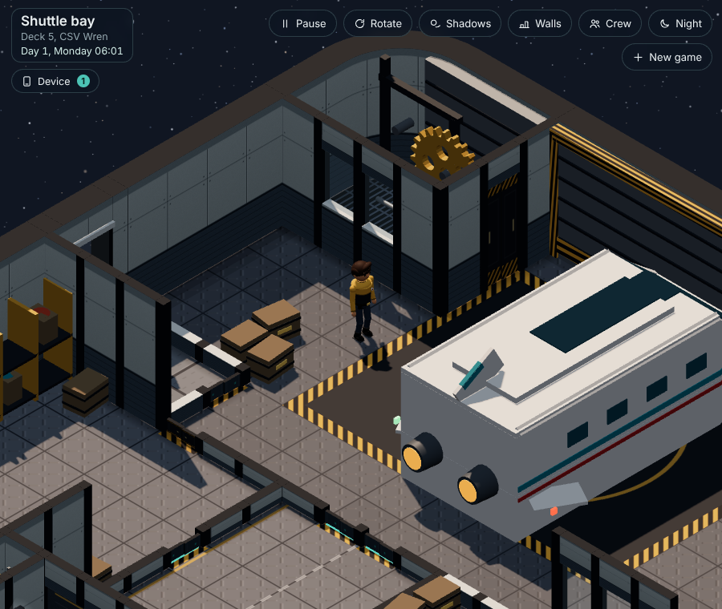
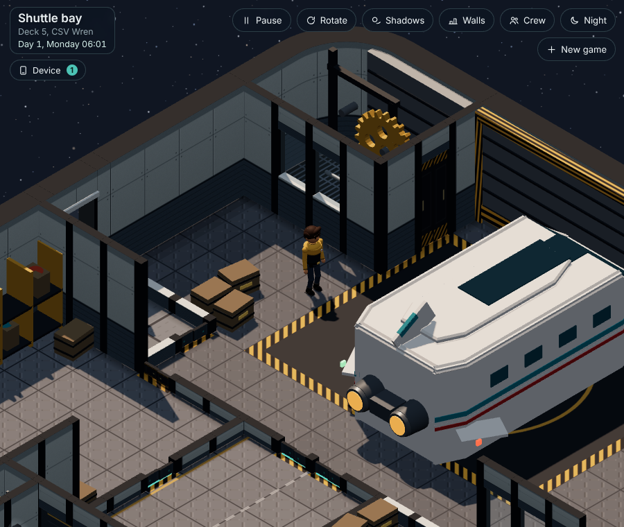
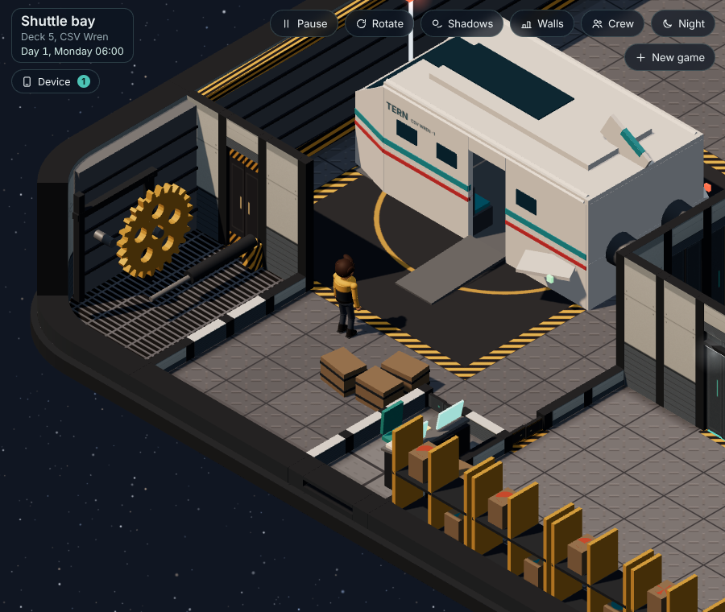
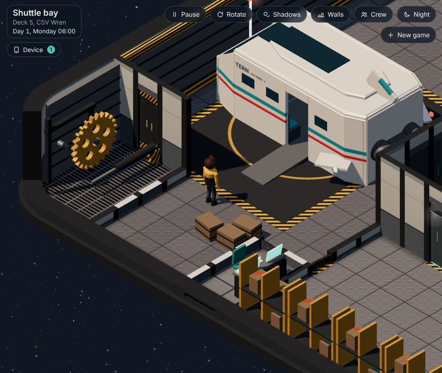
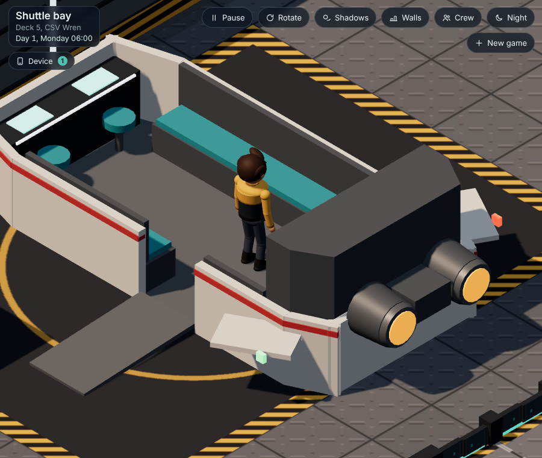

# The Tern, second pass: sleeker, less boxy (plan for the user)

Deck architect 5, 2026-10-18. The user said yes to "a second, sleeker pass on the Tern" (`plans/overnight-decisions.md`). This is what I'd change. Nothing is built yet: a quick trial on my own copy made the pictures below, so you can see it before deciding.

## What still looks boxy after the first pass (0.38.33)

The first pass tapered the **nose**, raked the windscreen, swept the wings and fin back and softened the roof's long edges. Seen from the back, the Tern is still a box: the **tail is a flat, full-width wall** with two engine discs stuck on it, the **roof's raised strip is a plain slab**, and the **nose and tail corners are sharp**.

## The changes (five small ones)

1. **The tail tapers like the nose.** The sides run straight, then angle in over the last 60 cm to a narrower back (the same width as the nose). The roof follows the taper and its back edge is softened like its sides.
2. **Engine pods instead of discs.** Each engine becomes a longer pod with a steel nozzle and the orange glow set inside it, joined by a short fairing between the two, so they read as built into the tail rather than stuck on.
3. **A shaped roof spine.** The raised strip on the roof narrows toward both ends and has bevelled edges, instead of a plain slab.
4. **Rounded corners.** The four corners where the sides meet the nose and the tail are cut off at an angle (softer from every camera angle).
5. **Inside, only the lockers change:** the locker wall across the back follows the new taper (a little narrower at its back corners). The benches, aisle, cockpit, door, ramp and floor are where they were.

## What stays the same

- Its size and the floor tiles it covers, the ramp (opening and closing, never closing on anyone), the aisle, benches, cockpit, the roof hiding while you're inside, and every place in it (the arrival scene still starts you in the aisle).
- The same colours and materials, so **the same number of draw calls** on Deck 5 (checked in the trial; the phone budget is unaffected).
- Crew plans: nothing the crew uses moves.

Not changed on purpose: the bottom edges of the hull (the Tern sits on the pad and they're hardly seen from the camera), and the length (it already fills its pad).

## Pictures (from the trial)

| Before | After |
| --- | --- |
|  |  |
|  |  |

Inside, after (the lockers follow the taper; the engines from close up): 

## If approved

One build (the next 0.47.x) on `claude/deck-p5s3`: the `shuttle` kit only. Checks: deck_check (Deck 5 draw calls and reach), cadet_test (Deck 4 only, so no differences expected), a crew plan comparison, and the arrival scene's start.
